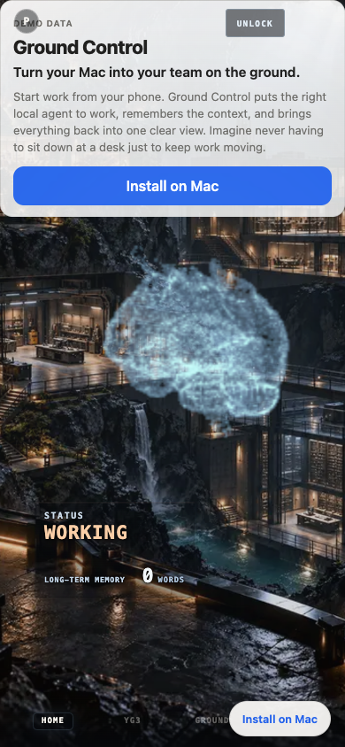
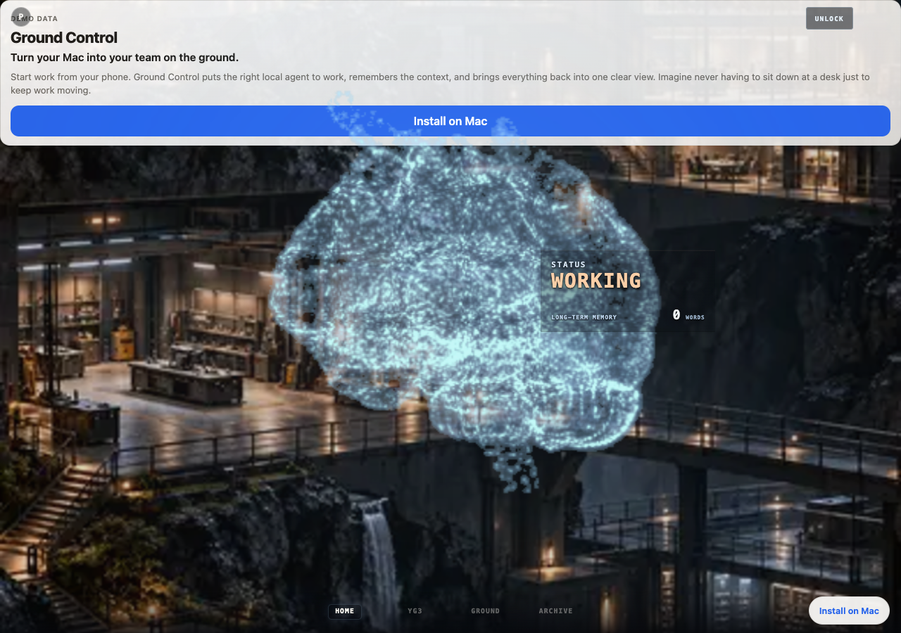

# Ground Control

**Turn your Mac into your team on the ground.**

Start work from your phone. Ground Control puts the right local agent to work, remembers the context, and brings everything back into one clear view. Imagine never having to sit down at a desk just to keep work moving.

## What you get

- **Phone-side control** — Start and steer work from your phone; agents run on your Mac in your real project folders.
- **Local agents** — Cursor and Kimi stay on your machine, where your code already lives.
- **Second Brain** — Optional Markdown vault for notes, search, and capture.
- **YG3 marketing data** — Optional read-only YG3 connection for growth and account signals on the owner board.

Official first release: **macOS only**. Windows is not supported.

## One-time setup, then automatic

Run setup once. It installs what’s needed, connects YG3 in the browser if you use it, helps you pick the right client workspace, and—if you say yes—**configures a background job** to keep YG3 data fresh (daily, at login, and after wake). You do **not** sign in to YG3 every day; reconnect only if access is revoked.

Your data stays local: tokens in Keychain, caches under `data/` (gitignored). The public demo board uses fixtures only.

## Public demo (anonymous board)

With `BOARD_PUBLIC_READ_ONLY=1`, `/board` shows the real suit HUD populated by fictional **Harbor Lantern Co.** data—no owner key required. Configure install and optional support links via `PUBLIC_REPO_URL` and `PUBLIC_DONATION_URL` in `.env` (see [.env.example](.env.example) and [docs/PUBLIC_DEMO.md](docs/PUBLIC_DEMO.md)). Forks can swap demo copy in `packages/relay/src/board-extensions/public-fiction.ts`.

### Product tour (screenshots)

| Mobile (390×844) | Desktop |
| --- | --- |
|  |  |

Regenerate after UI changes (relay running in public mode):

```bash
BOARD_BASE_URL=http://127.0.0.1:8787 node scripts/capture-board-screenshots.mjs
```

Repository: [github.com/YG3-ai/ground-control](https://github.com/YG3-ai/ground-control)

## Quick start (macOS)

```bash
git clone https://github.com/YG3-ai/ground-control.git ground-control
cd ground-control
npm run setup:mac
npm run doctor
```

`setup:mac` is guided and idempotent: it runs bootstrap/build when needed, creates config from examples, and walks through YG3 and Second Brain prompts. Edit `.env` and `config.yaml` when setup reminds you—use strong random secrets, never commit them.

Open the owner board at `http://127.0.0.1:8787/board` after relay and worker are running (see [Operator guide](docs/OPERATOR_GUIDE.md) for always-on services).

## Troubleshooting

| Situation | What to run |
| --- | --- |
| Check configuration | `npm run doctor` |
| YG3 access revoked | `npm run yg3:login` (one-time browser sign-in) |
| Pick a different client workspace | `npm run yg3:workspaces:search -- "query"` then `npm run yg3:select -- --ref N` |
| Remove background YG3 sync only | `npm run setup:mac:uninstall-yg3-sync` |
| Relay + worker development | `npm run relay` and `npm run worker` |

More: [docs/SETUP_MAC.md](docs/SETUP_MAC.md) · [docs/YG3_MCP_INTEGRATION.md](docs/YG3_MCP_INTEGRATION.md) · [docs/OPERATOR_GUIDE.md](docs/OPERATOR_GUIDE.md)

## Customize and contribute

Fork and adapt for your workflow. See [CONTRIBUTING.md](CONTRIBUTING.md).

## License

Free to use and customize for your own business. Do not repackage Ground Control as a competing product.

[PolyForm Shield 1.0.0](LICENSE) · [NOTICE](NOTICE)

## Support

- **Live demo (logged-out board):** [my.parthaunnava.com/board](https://my.parthaunnava.com/board) — fictional Harbor Lantern Co. data only; no owner access required.
- **Donate:** [support Ground Control on Stripe](https://donate.stripe.com/6oU5kD83bfj4fP4aDsb7y0j) (optional; helps fund macOS development).
